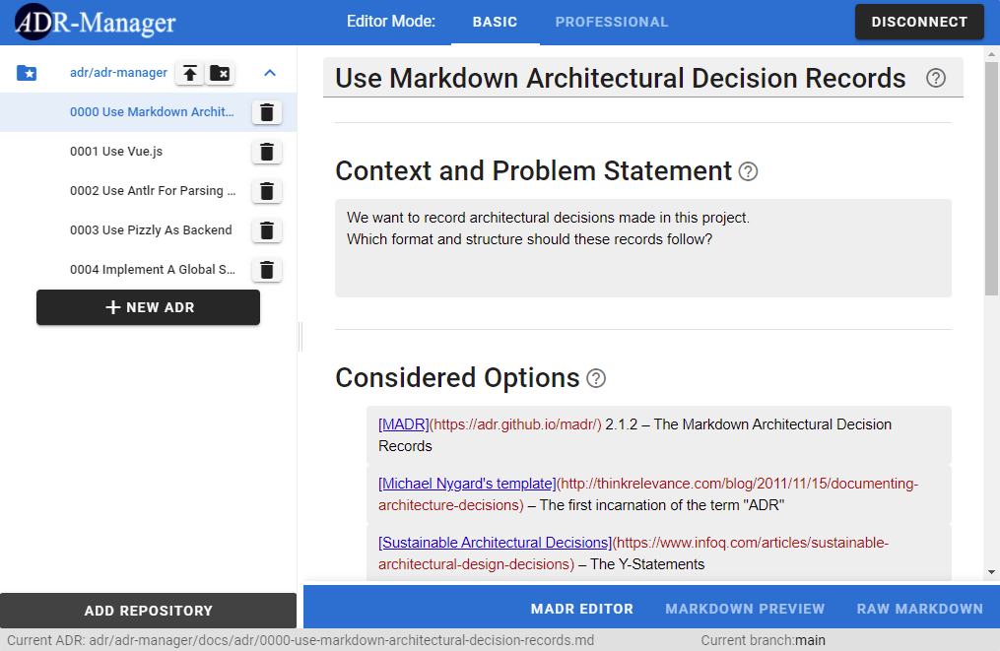

# ADR-Manager

> A web-based application for the efficient creation and management of [architectural decision records (ADRs)](https://adr.github.io) in Markdown (MADR)

## Description

[MADR](https://adr.github.io/madr/) is a Markdown template for quickly capturing architectural decisions.
It offers a naming scheme and template to keep the layout of recorded decisions consistent.
Each decision is stored in a separate file.
The ADR Manager currently only supports the management of MADRs stored in the folder `docs/adr` in GitHub repositories.

## Quick Start

You can find the tool at https://adr.github.io/adr-manager.

## Supported Browsers

Currently, the tool has been successfully tested in Chrome, Firefox, and Opera.

### Usage

1. After opening the tool, connect to GitHub. The tool needs your permission to access your GitHub repositories and email address.
2. Add a GitHub repository. If your account does not have access to a repository with MADRs, you can simply fork one, e.g., <https://github.com/JabRef/jabref> or <https://github.com/adr/adr-log>.
3. Now, you can edit any files in `docs/adr` of the GitHub repository.
   Edit existing ADRs or create new ones.
   One of the most important features is the MADR Editor that allows you to quickly draft a MADR while ensuring a consistent format.
   
4. Do not forget to push your changes to GitHub, once you are done with editing the files.

Some technical notes:

- The `authID` (which enables the connection to GitHub) and changes to ADRs are stored in the local storage.
  That way they are not lost when you reload the page or restart the browser.
  However, changes will be lost when you either
  - Clear local storage or
  - Press the `Disconnect` button.
- The general idea is that you directly push your changes to GitHub after editing.
- During development, we may remove permissions for the OAuth App from time to time.
  Do not be surprised, if you have to give permissions repeatedly.

## Project Context

This project was started as an undergraduate research project at the Institute of Software Engineering of the University of Stuttgart, Germany.
It was also submitted to the [ICSE Score Contest 2021](https://conf.researchr.org/home/icse-2021/score-2021).
Since then, it has been given over to the [ADR organization on GitHub](https://github.com/adr), where it is maintained and extended.
